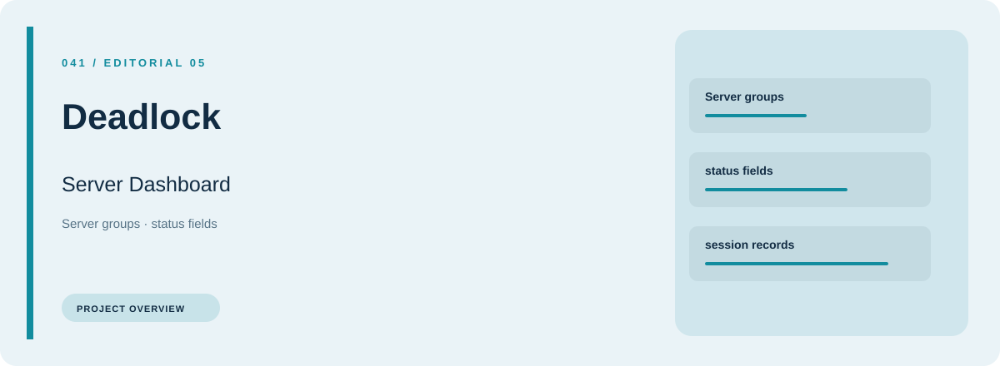
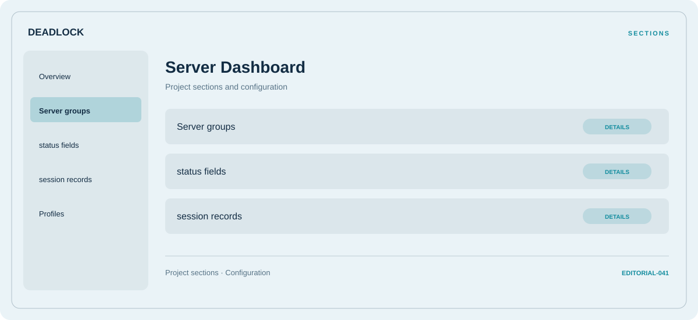

# 🎮 Deadlock Server Dashboard

**Server groups · Status fields · Session records**

## ⚡ Features

Deadlock Server Dashboard groups server groups, status fields, and session records in a single workspace. Each section keeps its controls and related settings together.

### ⚙️ Server groups

A dedicated section for server groups and the configuration details associated with that area.

### 🧩 Status fields

A dedicated section for status fields and the configuration details associated with that area.

### ⌨️ Session records

Session and activity information grouped by the task or context it belongs to.

## 🖥️ Project navigation

## 📥 Download

The button and cover open the project's download page. Use the information supplied with the downloaded package for installation and release-specific requirements.

## 📚 Project documentation

- [Feature reference](docs/FEATURES.md)
- [Download information](docs/DOWNLOAD.md)
- [Project page](index.html)

---

Deadlock Server Dashboard · Program documentation and download information.
